<!-- GENERATED FILE: edit content/*.json or design/themes.json, then run python scripts/build.py. -->

<!-- ==================== SECTION 01: IDENTITY / HERO ==================== -->
<!-- Regenerate hero assets: python scripts/generate_hero.py -->

  

<!-- Fallback:

  

-->

<!-- ==================== SECTION: ABOUT ME ==================== -->

  <picture>
    <source media="(prefers-color-scheme: dark)" srcset="./assets/headers/show-about-me.svg">
    <source media="(prefers-color-scheme: light)" srcset="./assets/headers/show-about-me-light.svg">
    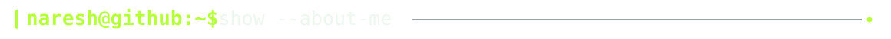
  </picture>

  <picture>
    <source media="(prefers-color-scheme: dark)" srcset="./assets/sections/about-me.svg">
    <source media="(prefers-color-scheme: light)" srcset="./assets/sections/about-me-light.svg">
    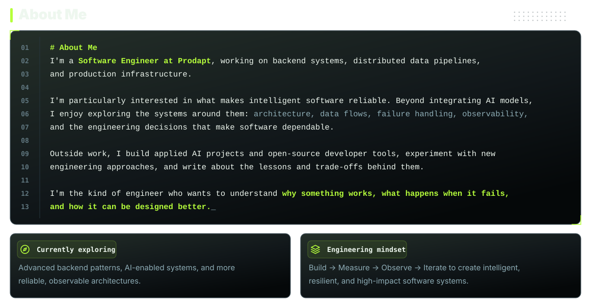
  </picture>

<!-- ==================== SECTION 02: ENGINEERING FOCUS ==================== -->
<!-- PROFILE:ENGINEERING-FOCUS:START -->

  <picture>
    <source media="(prefers-color-scheme: dark)" srcset="./assets/headers/inspect-engineering-focus.svg">
    <source media="(prefers-color-scheme: light)" srcset="./assets/headers/inspect-engineering-focus-light.svg">
    
  </picture>

  <picture>
    <source media="(prefers-color-scheme: dark)" srcset="./assets/engineering-focus/engineering-focus-dark.svg">
    <source media="(prefers-color-scheme: light)" srcset="./assets/engineering-focus/engineering-focus-light.svg">
    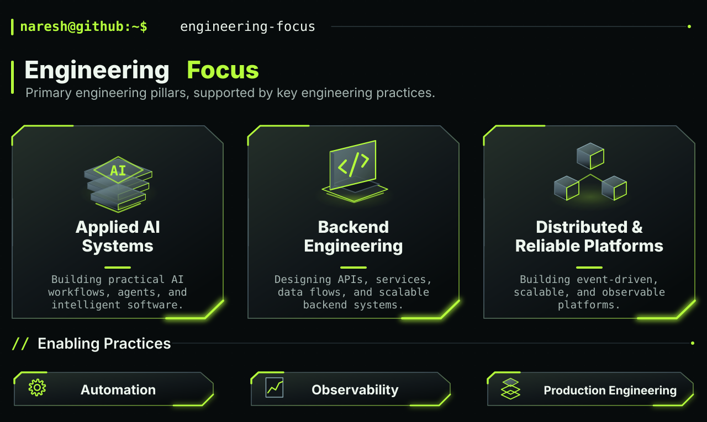
  </picture>

<!-- PROFILE:ENGINEERING-FOCUS:END -->

<!-- ==================== SECTION 03: FLAGSHIP PROJECTS ==================== -->

  <picture>
    <source media="(prefers-color-scheme: dark)" srcset="./assets/headers/ls-flagship-projects.svg">
    <source media="(prefers-color-scheme: light)" srcset="./assets/headers/ls-flagship-projects-light.svg">
    
  </picture>

  <picture>
    <source media="(prefers-color-scheme: dark)" srcset="./assets/headings/featured-projects.svg">
    <source media="(prefers-color-scheme: light)" srcset="./assets/headings/featured-projects-light.svg">
    
  </picture>

  <a href="https://github.com/Phoenixarjun/architecture-as-memory">
    <picture>
      <source media="(prefers-color-scheme: dark)" srcset="./assets/projects/architecture-as-memory.svg">
      <source media="(prefers-color-scheme: light)" srcset="./assets/projects/architecture-as-memory-light.svg">
      
    </picture>
  </a>

  <a href="https://github.com/Phoenixarjun/PromptNova">
    <picture>
      <source media="(prefers-color-scheme: dark)" srcset="./assets/projects/promptnova.svg">
      <source media="(prefers-color-scheme: light)" srcset="./assets/projects/promptnova-light.svg">
      
    </picture>
  </a>

  <a href="https://github.com/Phoenixarjun/CredFlow">
    <picture>
      <source media="(prefers-color-scheme: dark)" srcset="./assets/projects/credflow.svg">
      <source media="(prefers-color-scheme: light)" srcset="./assets/projects/credflow-light.svg">
      
    </picture>
  </a>

<!-- ==================== SECTION 04: CURRENTLY BUILDING ==================== -->

  <picture>
    <source media="(prefers-color-scheme: dark)" srcset="./assets/headers/status-currently-building.svg">
    <source media="(prefers-color-scheme: light)" srcset="./assets/headers/status-currently-building-light.svg">
    
  </picture>

  <picture>
    <source media="(prefers-color-scheme: dark)" srcset="./assets/headings/currently-building.svg">
    <source media="(prefers-color-scheme: light)" srcset="./assets/headings/currently-building-light.svg">
    
  </picture>

  <a href="https://github.com/Phoenixarjun/Agent-Toolkit">
    <picture>
      <source media="(prefers-color-scheme: dark)" srcset="./assets/now/agent-toolkit.svg">
      <source media="(prefers-color-scheme: light)" srcset="./assets/now/agent-toolkit-light.svg">
      
    </picture>
  </a>

<!-- ==================== SECTION 05: ENGINEERING STACK ==================== -->

  <picture>
    <source media="(prefers-color-scheme: dark)" srcset="./assets/headers/cat-engineering-stack.svg">
    <source media="(prefers-color-scheme: light)" srcset="./assets/headers/cat-engineering-stack-light.svg">
    
  </picture>

  <picture>
    <source media="(prefers-color-scheme: dark)" srcset="./assets/headings/engineering-stack.svg">
    <source media="(prefers-color-scheme: light)" srcset="./assets/headings/engineering-stack-light.svg">
    
  </picture>

  <picture>
    <source media="(prefers-color-scheme: dark)" srcset="./assets/stack/toolkit.svg">
    <source media="(prefers-color-scheme: light)" srcset="./assets/stack/toolkit-light.svg">
    
  </picture>

<!-- ==================== SECTION 06: TECHNICAL WRITING ==================== -->

  <picture>
    <source media="(prefers-color-scheme: dark)" srcset="./assets/headers/render-technical-writing.svg">
    <source media="(prefers-color-scheme: light)" srcset="./assets/headers/render-technical-writing-light.svg">
    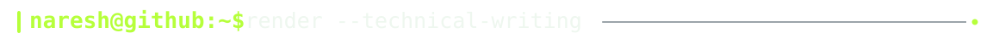
  </picture>

  <picture>
    <source media="(prefers-color-scheme: dark)" srcset="./assets/writing/header.svg">
    <source media="(prefers-color-scheme: light)" srcset="./assets/writing/header-light.svg">
    
  </picture>

<!-- BLOG-POST-LIST:START -->

  <a href="https://medium.com/@phoenixarjun007/i-build-with-ai-im-tired-of-how-it-s-sold-online-898c32240c36">
    <picture>
      <source media="(prefers-color-scheme: dark)" srcset="./assets/writing/row-01.svg">
      <source media="(prefers-color-scheme: light)" srcset="./assets/writing/row-01-light.svg">
      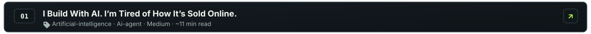
    </picture>
  </a>

  <a href="https://medium.com/@phoenixarjun007/when-your-backend-starts-building-a-workflow-engine-d0c7838af114">
    <picture>
      <source media="(prefers-color-scheme: dark)" srcset="./assets/writing/row-02.svg">
      <source media="(prefers-color-scheme: light)" srcset="./assets/writing/row-02-light.svg">
      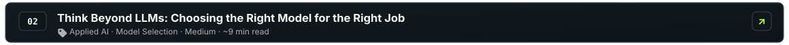
    </picture>
  </a>

  <a href="https://medium.com/@phoenixarjun007/think-beyond-llms-choosing-the-right-model-for-the-right-job-6a24e3ef0bf3">
    <picture>
      <source media="(prefers-color-scheme: dark)" srcset="./assets/writing/row-03.svg">
      <source media="(prefers-color-scheme: light)" srcset="./assets/writing/row-03-light.svg">
      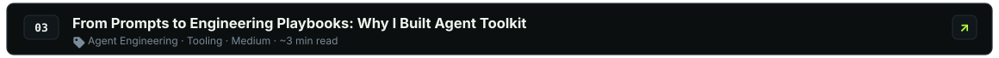
    </picture>
  </a>

<!-- BLOG-POST-LIST:END -->

<!-- ==================== SECTION 07: CONTRIBUTION ATLAS ==================== -->

  <picture>
    <source media="(prefers-color-scheme: dark)" srcset="./assets/headers/render-contribution-atlas.svg">
    <source media="(prefers-color-scheme: light)" srcset="./assets/headers/render-contribution-atlas-light.svg">
    
  </picture>

  <picture>
    <source media="(prefers-color-scheme: dark)" srcset="./assets/headings/contribution-atlas.svg">
    <source media="(prefers-color-scheme: light)" srcset="./assets/headings/contribution-atlas-light.svg">
    
  </picture>

  <picture>
    <source media="(prefers-color-scheme: dark)" srcset="./assets/contributions/atlas-animated.gif">
    <source media="(prefers-color-scheme: light)" srcset="./assets/contributions/atlas-static-light.svg">
    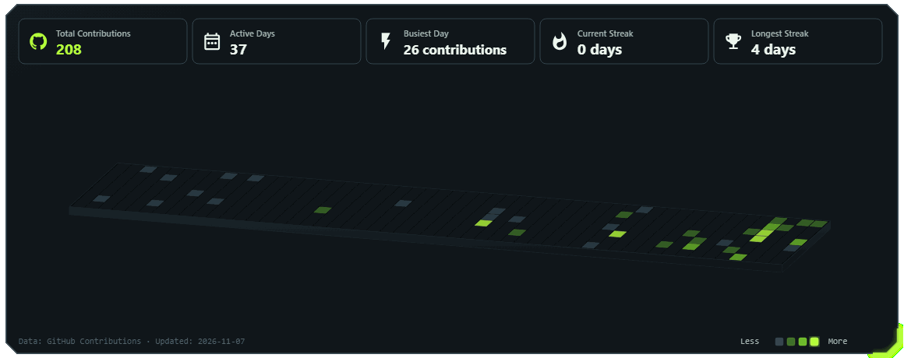
  </picture>

<!-- ==================== SECTION 08: DEVELOPER PLAYGROUND ==================== -->

  <picture>
    <source media="(prefers-color-scheme: dark)" srcset="./assets/headers/play-developer-arcade.svg">
    <source media="(prefers-color-scheme: light)" srcset="./assets/headers/play-developer-arcade-light.svg">
    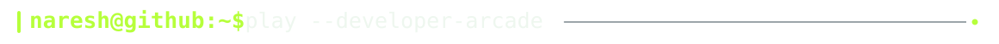
  </picture>

  <a href="https://phoenixarjun.github.io/Phoenixarjun/games/">
    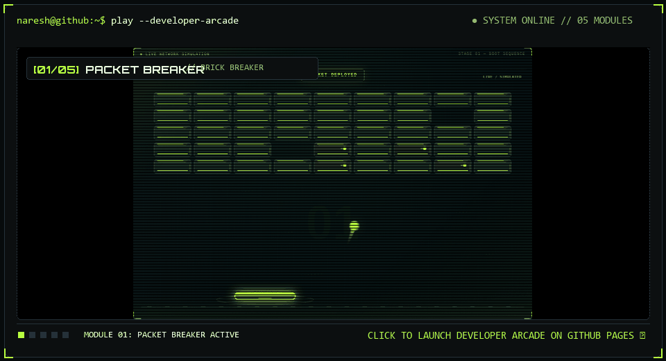
  </a>

  <a href="https://phoenixarjun.github.io/Phoenixarjun/games/packet-breaker/"><picture><source media="(prefers-color-scheme: dark)" srcset="./assets/sections/btn-packet-breaker.svg"><source media="(prefers-color-scheme: light)" srcset="./assets/sections/btn-packet-breaker-light.svg">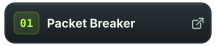</picture></a><a href="https://phoenixarjun.github.io/Phoenixarjun/games/circuit-pinball/"><picture><source media="(prefers-color-scheme: dark)" srcset="./assets/sections/btn-circuit-pinball.svg"><source media="(prefers-color-scheme: light)" srcset="./assets/sections/btn-circuit-pinball-light.svg">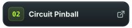</picture></a><a href="https://phoenixarjun.github.io/Phoenixarjun/games/runtime-rush/"><picture><source media="(prefers-color-scheme: dark)" srcset="./assets/sections/btn-runtime-rush.svg"><source media="(prefers-color-scheme: light)" srcset="./assets/sections/btn-runtime-rush-light.svg">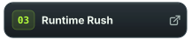</picture></a><a href="https://phoenixarjun.github.io/Phoenixarjun/games/firewall-defense/"><picture><source media="(prefers-color-scheme: dark)" srcset="./assets/sections/btn-firewall-defense.svg"><source media="(prefers-color-scheme: light)" srcset="./assets/sections/btn-firewall-defense-light.svg"></picture></a><a href="https://phoenixarjun.github.io/Phoenixarjun/games/stack-overflow/"><picture><source media="(prefers-color-scheme: dark)" srcset="./assets/sections/btn-stack-overflow.svg"><source media="(prefers-color-scheme: light)" srcset="./assets/sections/btn-stack-overflow-light.svg">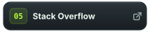</picture></a>

<!-- ==================== SECTION 09: CONNECT ==================== -->

  <picture>
    <source media="(prefers-color-scheme: dark)" srcset="./assets/headers/connect-all.svg">
    <source media="(prefers-color-scheme: light)" srcset="./assets/headers/connect-all-light.svg">
    
  </picture>

  <a href="https://github.com/Phoenixarjun"><picture><source media="(prefers-color-scheme: dark)" srcset="./assets/sections/btn-github.svg"><source media="(prefers-color-scheme: light)" srcset="./assets/sections/btn-github-light.svg"></picture></a><a href="https://www.linkedin.com/in/naresh-b-a-1b5331243/"><picture><source media="(prefers-color-scheme: dark)" srcset="./assets/sections/btn-linkedin.svg"><source media="(prefers-color-scheme: light)" srcset="./assets/sections/btn-linkedin-light.svg"></picture></a><a href="https://medium.com/@phoenixarjun007"><picture><source media="(prefers-color-scheme: dark)" srcset="./assets/sections/btn-medium.svg"><source media="(prefers-color-scheme: light)" srcset="./assets/sections/btn-medium-light.svg"></picture></a><picture><source media="(prefers-color-scheme: dark)" srcset="./assets/sections/btn-portfolio.svg"><source media="(prefers-color-scheme: light)" srcset="./assets/sections/btn-portfolio-light.svg"></picture>

<!-- ==================== FINAL LOGOUT FOOTER ==================== -->

  <picture>
    <source media="(prefers-color-scheme: dark)" srcset="./assets/headers/logout.svg">
    <source media="(prefers-color-scheme: light)" srcset="./assets/headers/logout-light.svg">
    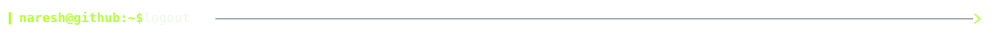
  </picture>

  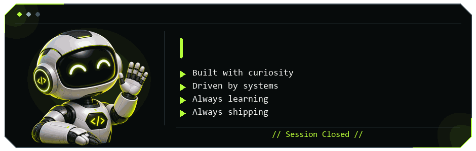

<!-- Static Fallback:

  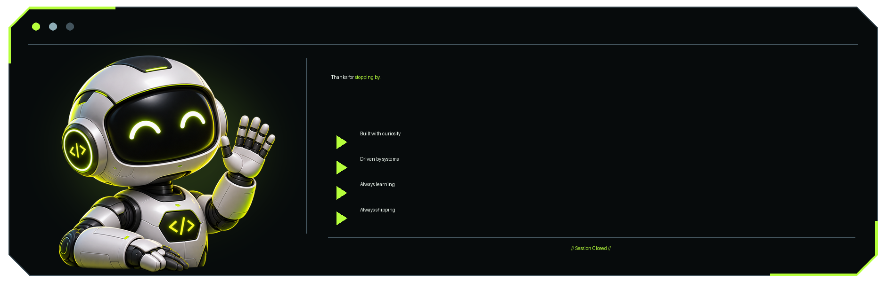

-->

