<!-- GENERATED FILE: edit content/*.json or design/themes.json, then run python scripts/build.py. -->

<!-- ==================== SECTION 01: IDENTITY / HERO ==================== -->
<!-- Regenerate hero assets: python scripts/generate_hero_svg.py && python scripts/render_hero_gif.py -->

  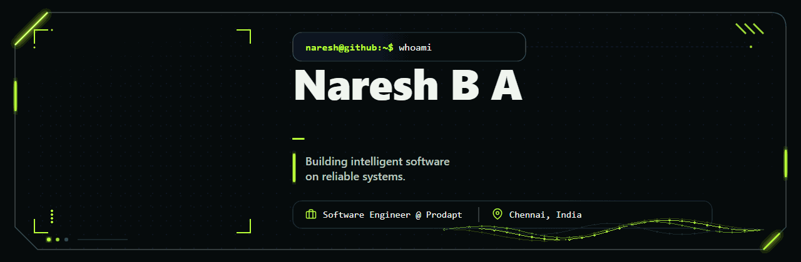

<!-- Fallback:

  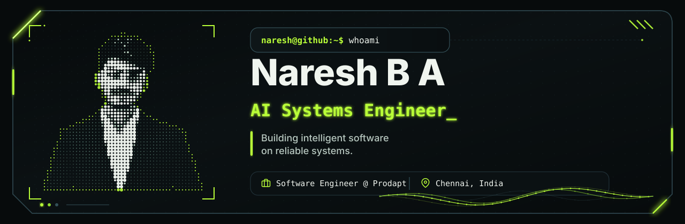

-->

<!-- ==================== SECTION 02: ENGINEERING FOCUS ==================== -->

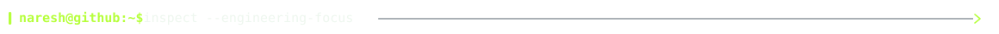

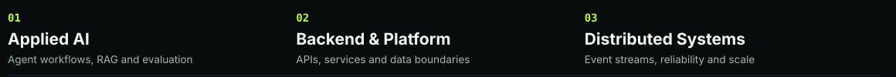

<!-- ==================== SECTION 03: FLAGSHIP PROJECTS ==================== -->

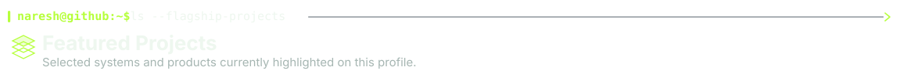

  <a href="https://github.com/Phoenixarjun/architecture-as-memory">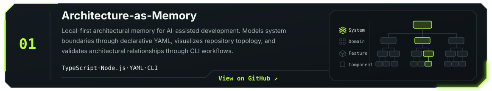</a>

  <a href="https://github.com/Phoenixarjun/PromptNova">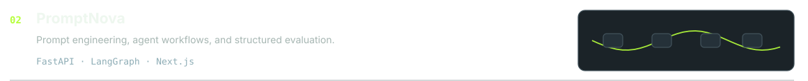</a>

  <a href="https://github.com/Phoenixarjun/CredFlow">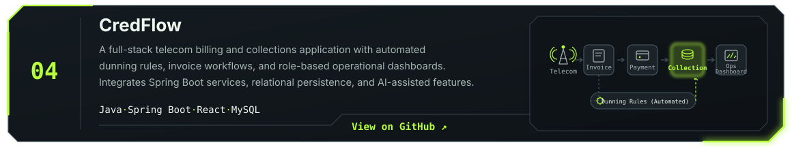</a>

<!-- ==================== SECTION 04: CURRENTLY BUILDING ==================== -->

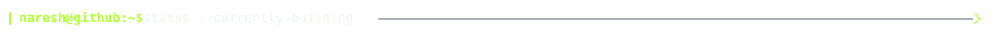

  <a href="https://github.com/Phoenixarjun/Agent-Toolkit">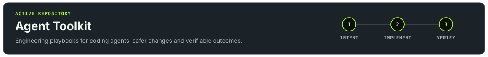</a>

<!-- ==================== SECTION 05: ENGINEERING STACK ==================== -->

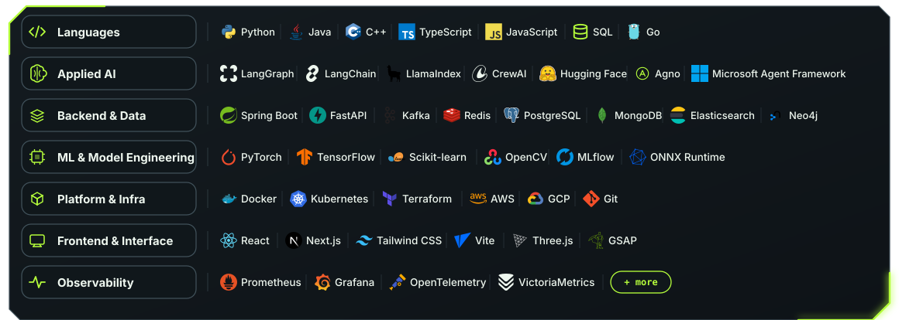

<!-- ==================== SECTION 06: TECHNICAL WRITING ==================== -->

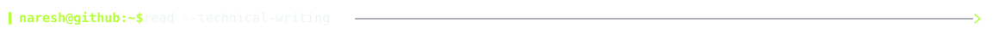

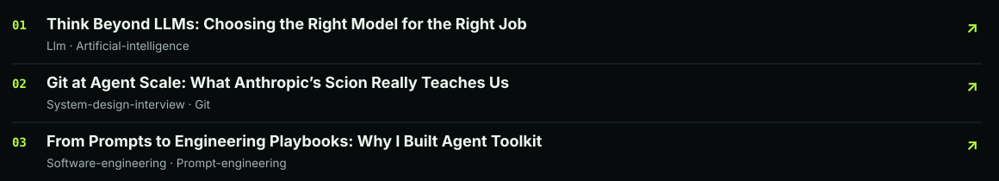

<!-- BLOG-POST-LIST:START -->
- **[Think Beyond LLMs: Choosing the Right Model for the Right Job](https://medium.com/@phoenixarjun007/think-beyond-llms-choosing-the-right-model-for-the-right-job-6a24e3ef0bf3)**
- **[Git at Agent Scale: What Anthropic’s Scion Really Teaches Us](https://medium.com/@phoenixarjun007/git-at-agent-scale-what-anthropics-scion-really-teaches-us-fa7bcfa09ade)**
- **[From Prompts to Engineering Playbooks: Why I Built Agent Toolkit](https://medium.com/@phoenixarjun007/from-prompts-to-engineering-playbooks-why-i-built-agent-toolkit-efb3f6a7298e)**
- **[Designing a Production RAG Retrieval System for 500 Million Vectors](https://medium.com/@phoenixarjun007/designing-a-production-rag-retrieval-system-for-500-million-vectors-35dac7566d83)**
- **[Scaling Vector Search to 500 Million Vectors: The Architecture Behind It](https://medium.com/@phoenixarjun007/scaling-vector-search-to-500-million-vectors-the-architecture-behind-it-950458403e97)**
<!-- BLOG-POST-LIST:END -->

<!-- ==================== SECTION 07: CONTRIBUTION ATLAS ==================== -->

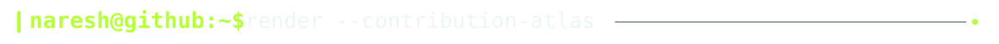

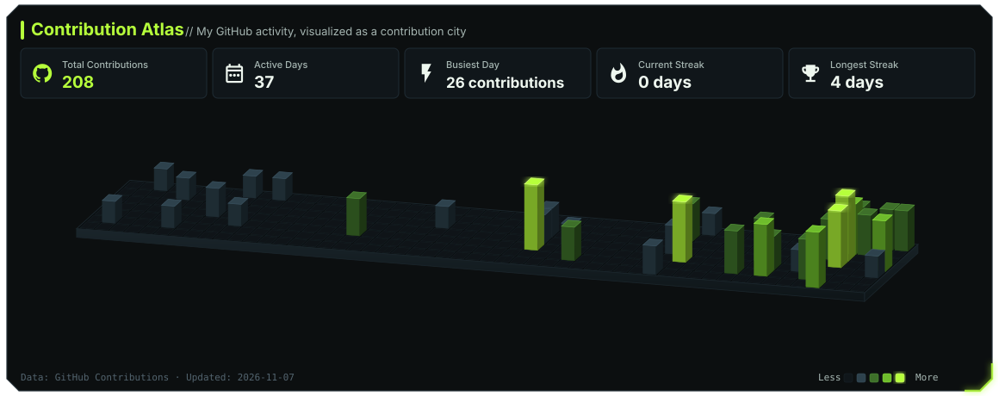

<!-- ==================== SECTION 08: DEVELOPER PLAYGROUND ==================== -->

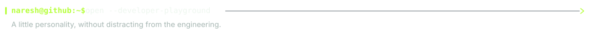

A little personality, without distracting from the engineering.

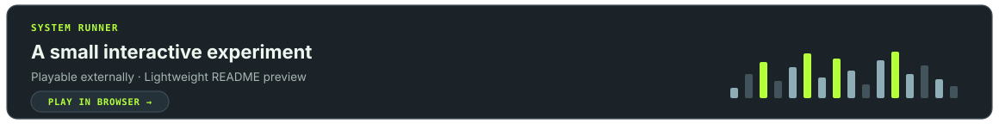

<!-- ==================== SECTION 09: CONNECT ==================== -->

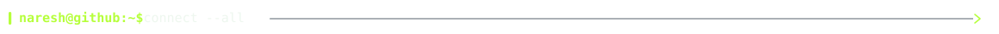

   &nbsp;
   &nbsp;
   &nbsp;
  

  Building intelligent software on reliable systems. 
  <code>VARIATION 01 / TERMINAL EDITORIAL</code>

