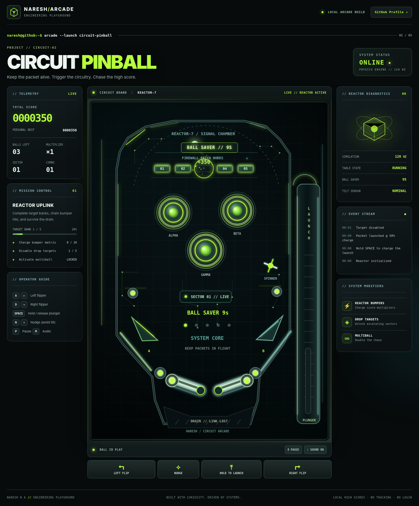

# CIRCUIT PINBALL — Titanium Hacker Arcade

**A separate, playable 2.5D pinball game for a future five-game GitHub Pages arcade.** Built with plain HTML/CSS/Canvas JavaScript and no network, installation, login, or external assets.



## Run it

- **Instant offline:** Open `standalone.html` in a desktop browser (all JavaScript and CSS are bundled inline).
- **Editable development:** Open `index.html` in your browser or serve this directory using `python -m http.server 8000` and visit `http://localhost:8000`. Scripts are classic JavaScript, so local `file://` also works in compatible browsers.
- **Deployment:** Copy this directory to a static host. `index.html` uses relative paths, so it works under a nested GitHub Pages directory.

## Controls

| Action | Desktop | Touch |
|---|---|---|
| Left flipper | A / Left arrow | LEFT FLIP button or left half of table |
| Right flipper | D / Right arrow | RIGHT FLIP button or right half of table |
| Launch | Hold SPACE, then release | Hold LAUNCH, then release |
| Nudge | N / Up arrow | NUDGE button |
| Pause / resume | P | Pause button |
| Toggle sound | M | Sound button |
| Restart | R | End-game "Play again" button |

## Gameplay

The silver packet is the pinball. Control two spring-driven flippers, launch using a charged plunger, activate three reactor bumpers, break five firewall targets, and survive the open center drain. Clear target banks to advance through **five sectors** and increase the scoring multiplier. Clearing multiple banks may trigger **multiball**. An **extra ball** is awarded at ascending score thresholds (capped at five stored balls). An early drain can trigger a **single-use ball saver** for that ball. Three rapid nudges trigger **tilt protection**, which temporarily disables flippers. Your best score is stored locally with `localStorage` (if available).

The game includes touch controls, keyboard controls, pause on window blur, synthesized audio (which can be muted), reduced-motion CSS support, and responsive side panels. No telemetry, tracking, external APIs, or permissions are requested.

## Source layout

```text
circuit-pinball-titanium/
  index.html             # Editable game markup (uses local source files)
  standalone.html        # Self-contained offline build, no asset requests
  style.css              # Titanium Hacker responsive UI
  src/
    physics.js           # Collision primitives and swept collision tests
    render.js            # 2.5D Canvas pinball table and visual effects
    audio.js             # Browser-generated sound effects
    game.js              # Physics-integrated gameplay/state/controls
  assets/
    favicon.svg
    preview-desktop-menu.png
    preview-desktop-playing.png
    preview-mobile-menu.png
    circuit-pinball-gameplay.gif
  tests/
    physics.test.cjs
    browser_smoke.py
    gameplay_scenarios.py
    physics-results.txt
  tools/
    build_standalone.py
    build_preview_gif.py
    export_to_profile.py
  docs/
    PHYSICS_AND_DESIGN.md
    ANTIGRAVITY_INTEGRATION.md
  arcade.manifest.json
```

## Physics architecture

- Logical table: **760 × 1080** design units, Canvas scales for display size and device-pixel ratio.
- **Fixed timestep: 1/120 s**, with a capped accumulator to avoid the spiral of death when returning from an inactive tab.
- **Substepping:** the packet movement is subdivided adaptively so each integration segment stays near or below 4.6 logical pixels.
- Collision responses use geometric normals and coefficient-of-restitution impulses.
- **Moving flippers:** angular position, velocity at the contact point `ω × r`, and multiple angular sweep samples prevent missed bat contacts.
- Walls and rails use finite line segments; bumpers use circles; target plates use axis-aligned boxes.
- `physics.js` also exposes swept circle-vs-circle and circle-vs-capsule functions, with dedicated tests.
- Ball speed capped at 1860 logical units per second to limit instabilities.
- **Important:** this is an arcade-style **2D pinball physics approximation with 2.5D rendering**. It is not a full mechanical 3D rigid-body simulation. Real pinball cabinet friction, spin, magnetism, and continuous rigid-body dynamics are beyond this scope.

See [Physics and Design](docs/PHYSICS_AND_DESIGN.md) for derivations, constraints, and tests.

## Validation

Run:

```sh
node --test tests/physics.test.cjs
python tests/browser_smoke.py
python tests/gameplay_scenarios.py
```

18 deterministic physics tests pass (including **20,000 randomized collision cases**), and Chromium browser scenarios cover launch, target collisions, bumper scoring, bank completion, multiball, tilt protection, ball drains, pause, audio, mobile touch controls, and a 15,000-frame simulation. A no-input session was also simulated and reached game over after three lost balls, confirming that passive flippers cannot keep the ball in play indefinitely.

These are engineering checks, not a guarantee that every game session has been balanced through human playtesting. Continue tuning difficulty with real players before a public arcade launch.

## Future arcade integration

**Keep this as an independent game.** The existing Packet Breaker remains separate. A future arcade home page can discover both through `arcade.manifest.json`; don't prepublish unfinished games or alter the GitHub profile README during this step.

Read [Antigravity Integration](docs/ANTIGRAVITY_INTEGRATION.md) before copying into `Phoenixarjun/Phoenixarjun`. No files here change your GitHub repository or Pages settings automatically.
