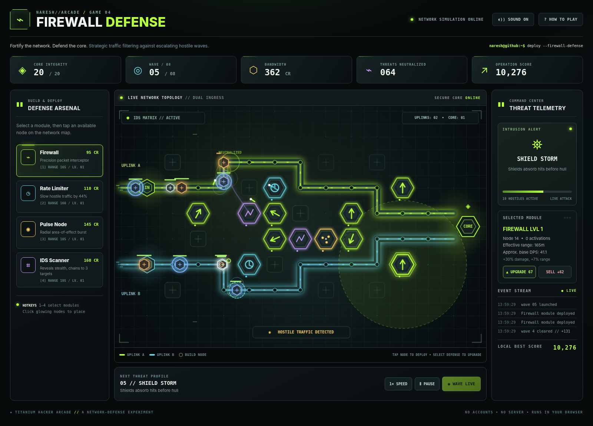

# FIREWALL DEFENSE — Titanium Hacker Arcade

**Game 04 of 05** · Standalone tactical network-defense game · HTML5 Canvas · no packages required to play.

Fortify two ingress routes before hostile packets reach the core. Buy defenses, upgrade modules, manage bandwidth credits, and survive eight escalating attack waves. Unlike the preceding arcade games, this is a strategy and resource-allocation game—not a timing or reflex-only challenge.



## Play

- **Fastest:** open `standalone.html` directly in a modern browser. Everything is embedded, including the JavaScript, CSS, and textures drawn in Canvas.
- **Editable development version:** run `python -m http.server 8000` in this folder, then navigate to `http://localhost:8000/index.html`. ES modules require an HTTP origin in many browsers.
- **GitHub Pages:** place `index.html`, `style.css`, and `src/` together in a published folder. No build pipeline, API key, database, CDN, analytics, or external asset host is needed.

## Controls

| Input | Action |
|---|---|
| Click / tap a defense in the Arsenal | Select module type |
| `1`, `2`, `3`, `4` | Select Firewall / Rate Limiter / Pulse / IDS |
| Click / tap an empty glowing network node | Build selected defense (if affordable) |
| Click / tap a deployed defense | Inspect / upgrade / sell |
| Keyboard-focus the Canvas, arrow keys + Enter | Navigate and build on a placement node |
| Space or Deploy Wave | Start next enemy wave |
| P or Pause | Pause / resume active wave |
| 1× / 2× Speed | Accelerate the simulation, not the underlying mathematics |
| On a phone | Swipe the board horizontally to reach distant nodes |

## Defensive modules

| Module | Cost | Strategy |
|---|---:|---|
| **Firewall** | 95 CR | Fast precision interception, solid single-target damage |
| **Rate Limiter** | 110 CR | Slows packets by 44% for 1.7 simulated seconds |
| **Pulse Node** | 145 CR | Radial damage to groups near the tower |
| **IDS Scanner** | 160 CR | Full-range stealth detection plus chaining between targets |

Towers can be upgraded twice (levels 2 and 3) and sold for 65% of total invested bandwidth. Incoming packets include Probes, Bursts, Armored payloads, Stealth threats, Shielded threats, and a final Titan.

## Technical design

- Fixed-step simulation: `1/120` seconds; independent of Canvas frame rate.
- Enemy movement: distance along deterministic polyline routes.
- Projectile collision: swept line-segment to circle intersection to reduce tunneling.
- Tower targeting: highest normalized progress toward the core, within range; stealth has reduced visibility except to IDS.
- Economy: spending, kill rewards, streak bonuses, wave-clearing credits, upgrades, and resale.
- Reproducibility: seeded xorshift32 RNG, deterministic simulation paths.
- Visuals: original procedural 2.5D Canvas board, particle glows, attack beams, pulse rings, shields, and scanline grid. No Three.js dependency; this is not a 3D physics engine.
- Persistence: optional local browser high score only; no online leaderboard or tracking.

See [`docs/ENGINE_AND_BALANCE.md`](docs/ENGINE_AND_BALANCE.md).

## Testing

From this directory:

```bash
node --test tests/engine.test.mjs
python build_standalone.py
python tests/browser_smoke.py   # optional: needs Playwright + system Chromium
```

Automated tests cover core rules, 15,000 randomized projectile collisions, tower economics, visibility, shields, wave progression, winnability with a demonstrated defensive strategy, loss with an underpowered strategy, and restart.

Browser smoke tests cover placing towers, launching waves, pausing, resuming, speed toggling, upgrades, help dialog, mobile touch input, and lack of page-level horizontal overflow.

## Structure

```text
firewall-defense-titanium/
├── index.html                # editable browser entry point (modules)
├── standalone.html           # generated single-file offline game
├── style.css                 # theme and responsive HUD
├── src/
│   ├── engine.mjs            # pure strategy simulation
│   ├── renderer.js           # procedural Canvas visualization
│   └── main.js               # controls, HUD, sound and persistence
├── build_standalone.py       # first-party module bundler, no packages
├── scripts/export_to_profile.py
├── arcade-manifest.json      # metadata for future five-game portal
├── tests/engine.test.mjs
├── tests/browser_smoke.py
├── docs/
│   ├── ENGINE_AND_BALANCE.md
│   └── ANTIGRAVITY_INTEGRATION.md
├── assets/                   # real screenshots and gameplay GIF
└── previews/                 # actual desktop/mobile browser captures
```

**Not yet deployed:** Nothing here modifies `Phoenixarjun/Phoenixarjun`, its README, Pages settings, or deployment workflows. See the integration guide for a safe future arcade structure.
