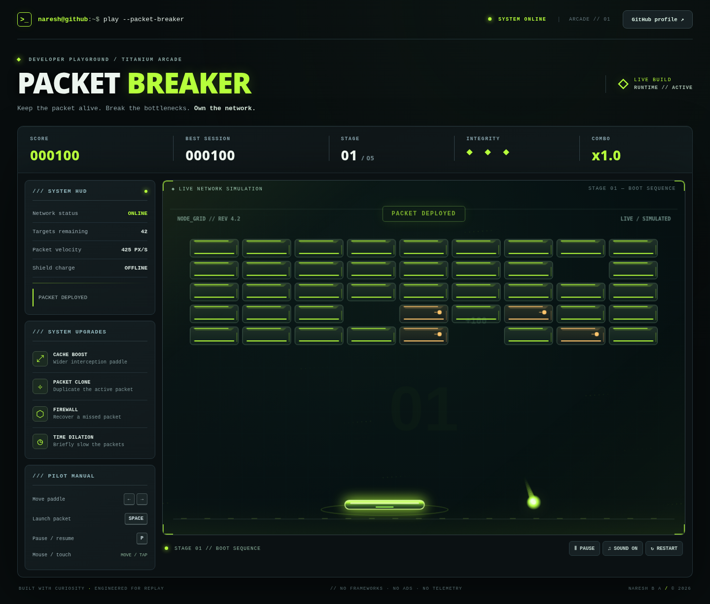

# PACKET BREAKER // Titanium Hacker Arcade

**A complete, local-first, 2.5D neon brick-breaker.** No runtime libraries, trackers, accounts, network requests, downloads, or backend services required.



## Play immediately

Extract the ZIP, open `index.html` (or the self-contained `standalone.html`) in a modern browser, click **INITIALIZE RUN**, then **click/tap the arena** or press **Space** to deploy your packet. The game works locally because `index.html` loads the prebuilt `dist/game.bundle.js`, which is a standard browser script, not an ES module.

**Controls:** Mouse/touch drag or left/right arrows (A/D) to move. Space/click to launch. P or Escape to pause. Sound, pause and restart buttons are below the arena. On mobile, landscape orientation provides a bigger playfield.

## Features

- **5 handcrafted stage patterns** (BOOT SEQUENCE, QUEUE STORM, LOAD BALANCER, FAULT DOMAIN, KERNEL PANIC), then optional endless mode after winning.
- **Arcade paddle physics:** 120 Hz fixed-timestep simulation, precise swept-circle collision against rectangle faces **and rounded corners**, collision-time paddle placement, controllable ricochet angles, bounded speeds, multiple collision iterations per step.
- **Four collectible boosts:** CACHE (paddle grows, 14 seconds), PACKET CLONE (multi-ball up to 6 active packets), FIREWALL (save a missed packet), TIME DILATION (slower packets for 11 seconds).
- Destructible and reinforced bricks, explosive chain-reaction bricks, high-durability core targets, per-hit particles, score popups, combo multiplier, lives, game-over and stage-clear screens.
- Custom 2.5D metallic visuals with shadows, glow, surface facets, particle trails, sound synthesized with Web Audio, and device scaling up to 2× pixel density.
- High score stored locally in browser `localStorage`; does not send data anywhere. Graceful storage/sound fallbacks.
- Pauses when you switch browser tabs. Respects reduced-motion preferences. Keyboard, mouse and touch controls. No external CSS, JS or assets.

## Files

```text
packet-breaker-titanium/
├── index.html                   # Main browser entry point
├── standalone.html              # All-in-one offline build, HTML + CSS + JS
├── style.css                    # Titanium Hacker layout & mobile breakpoints
├── dist/game.bundle.js          # Prebuilt runtime (included; works with file://)
├── src/game.js                  # Editable gameplay / canvas renderer
├── src/physics.mjs              # Pure geometry + collision helpers
├── scripts/build.mjs            # Rebuild runtime from source, no dependencies
├── scripts/export-pages.mjs     # Optional copy into a local profile repository
├── tests/physics.test.mjs       # Node built-in test runner
├── assets/                      # Favicon and screenshots / GIF preview
└── docs/                        # Implementation and verification instructions
```

## Edit and test

Requires Node 20+ **only if modifying the source**; no build step is needed for playing the pre-built game.

```bash
node --test tests/physics.test.mjs
node scripts/build.mjs
```

You can safely tune stage patterns, velocities, paddle sizing, power-ups and graphics in `src/game.js`. `src/physics.mjs` holds the mathematical collision rules; rebuild after changes. Never edit `dist/game.bundle.js` directly.

**Color palette:** Base `#0C0F10`, Deep `#070B0C`, Surface `#1B2328`, Steel `#42535C`, Accent `#B6FF3B`, Text `#EEF7EF`.

## Deploy with GitHub Pages

This package is **not deployed**. For the `Phoenixarjun/Phoenixarjun` repo, review `docs/ANTIGRAVITY_INTEGRATION.md` and `docs/GITHUB_PAGES_AND_README.md`. The included exporter can copy only the runtime files into `docs/packet-breaker/` of a local checkout; it does **not** push or change your GitHub settings.

A GitHub README cannot execute the game directly. Embed its image/GIF preview as a link to the published GitHub Pages game **after confirming the URL works**. Keep the README preview and the playable game separate.

## Validation scope

- 17 geometry tests, including 10,000 randomized collision sweeps.
- Browser smoke tests: start, launch, score changes after a hit, pause/resume, sound toggle, game-over, and mobile touch.
- Desktop and mobile screenshot review; 390px mobile had no horizontal overflow.
- The entire five-stage campaign has **not** been human-playtested end-to-end. Difficulty balance and feel should be refined with actual players before calling this production-final.

Made for the GitHub Profile 2.0 Developer Playground. Built with curiosity and engineered for replay.
