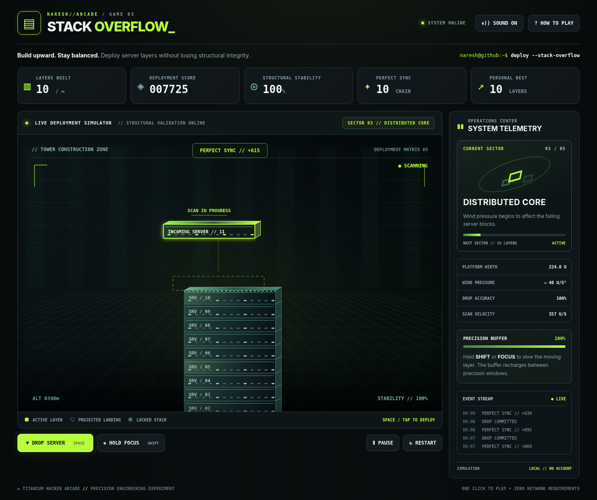

# Stack Overflow — Titanium Hacker Arcade // Game 05

**A playable server-tower precision game.** Drop moving server modules onto the existing stack; a clean connection preserves the platform, while overhang is cut away. The tower becomes harder to maintain as scan speed and wind pressure rise.



## Run

Double-click **`standalone.html`** in a modern browser. It contains the HTML, CSS, physics, and renderer inline, with no runtime downloads. Alternatively, open `index.html` using a local static web server (the module-based source version): `python -m http.server 8000` then browse to `http://localhost:8000/`. No node_modules, account, or API is required.

## Controls

| Action | Desktop | Mobile |
| --- | --- | --- |
| Start | Start Deployment button | Start Deployment button |
| Drop | Space or click the arena | Tap the arena or DROP SERVER |
| Focus / slow scan | Hold Shift or Focus button | Hold Focus button |
| Pause/resume | P or button | Pause button |
| Restart | R or button | Restart button |

## Mechanics

- **Moving server blocks** oscillate horizontally before release; after release they fall under gravity with residual horizontal momentum and sector-dependent wind.
- **Collision geometry:** block landing uses an exact time-of-contact interpolation during the fixed timestep. The intersection of the falling rectangle and supporting rectangle defines retained width.
- **Overhang:** unsupported portions are cut away; sufficiently small overlaps fail. A center-aligned perfect placement snaps within a seven-unit tolerance and repairs at most two units of width.
- **Stability:** the horizontal center of mass of the accumulated upper tower is checked at each support interface. Insufficient support ends the run.
- **Focus resource:** hold Shift (or Focus) to slow the moving block. It drains while active and recharges naturally or on successful placements.
- **Five sectors:** Bootstrap, Load Balance, Distributed Core, High Availability, and Hyperscale, with progressively increasing scan speed and wind.
- **Progression:** build beyond the fifth sector for an endless high-score attempt. Local best is saved in browser storage if allowed.

## Architecture

- `src/physics.mjs`: deterministic simulation, fixed timestep, gravity, landing geometry, overlap, stability, scoring, stage data.
- `src/renderer.js`: Canvas 2D 2.5D graphics, metallic server blocks, projected landing guide, floor, neon effects, tower camera.
- `src/main.js`: input, AudioContext sounds, HUD, state transitions, browser persistence.
- `index.html` + `style.css`: readable, responsive modular edition.
- `standalone.html`: single-file distribution built by `build_standalone.py`.
- `tests/physics.test.mjs`: Node built-in test runner, no packages.
- `tests/browser_smoke.py`: optional Chromium+Playwright smoke test; uses bundled standalone markup.
- `scripts/export_to_profile.py`: conservative exporter for the future GitHub Pages arcade.

## Test

```bash
node --test tests/physics.test.mjs
python build_standalone.py
```

The mathematical simulation is intentionally **2D with a 2.5D visual projection**, not a full rigid-body 3D physics engine. This provides reliable, responsive gameplay and predictable collisions on mobile as well as desktop. Sound is locally synthesized and may be muted; there are no audio downloads.

See `docs/ENGINEERING_AND_PHYSICS.md` for the collision math, test scenarios and trade-offs. See `docs/ANTIGRAVITY_INTEGRATION.md` for deployment into the five-game arcade.

**Deployment:** The game is built as a standalone artifact, not yet deployed to GitHub Pages. Its presence here does not activate or overwrite any existing profile or Pages deployment.
